  

### Field Notes

I'm drawn to the *why* behind circuits. Look closely and DC, AC and transient analysis, signals and control turn out to be one theory wearing different clothes: a single operator, read in different ways. The textbooks teach them as separate subjects. I suspect that is not an accident.

That theory points me toward **learning-based control**: systems that rewrite their own rules from data while remaining provably stable and safe. Classical control theory guarantees stability and robustness from a model; intelligent control learns the system when no model exists. Joining the two is how you let a machine improvise without the world noticing that anything has changed. Paradox, after all, only punishes what it can see.

My other path is hardware, where Forces are given a body. The two meet where I'd like to work: quantum control, where qubit pulses are designed and calibrated by learning; analog and neuromorphic chips, where the learning controller lives in the circuit itself and learns the way nerves do on a sliver of power; and particle accelerators, where reinforcement learning and Bayesian optimization keep a beam stable while thousands of magnets must agree on a single path. Some would call these engineering problems. They are, mostly.

**Currently**
- Studying signals and systems, and probability and random variables (the Sphere of Entropy, though the syllabus calls it something else)
- Building a Monte Carlo simulation project on probabilistic computing (p-bits), where noise is not an error but a resource
- Writing *Circuits and Systems*, a book on an operator-based approach to circuit theory, in plain sight

### Tools

**Circuits** 

**Programming** 

**Embedded** 

**Workflow** 

### Off the Record

When I'm not chasing a theory, I'm rolling d10s in tabletop role-playing games, playing board games and video games, traveling, and hunting down good food and cocktails. At METU NCC, I'm part of the Fantastic Fiction Society, a small Chantry where fantasy and sci-fi fans gather. We only talk about fiction. Officially.

I used to chart the dark between the stars for people who wanted every map finished. I left when I saw which regions they refused to draw. These days I keep my instruments tuned to a medium the textbooks stopped mentioning in 1887.

